<div align="center">


<br>

<a href="https://www.linkedin.com/in/sayedali-dev">linkedin</a> &nbsp;&middot;&nbsp;
<a href="https://x.com/seyallius">x</a> &nbsp;&middot;&nbsp;
<a href="https://t.me/rdensh01">telegram</a> &nbsp;&middot;&nbsp;
<a href="mailto:seyed.ali.devl@gmail.com">email</a>

</div>

<br>

### `$ cat about.md`

```text
role      Go backend engineer. Scalable systems that don't fall over.
obsessed  Rust: systems, CLI tools, memory safety and speed.
origin    3+ years of Java and Spring Boot microservices.
creed     Simplicity, concurrency and performance are not trade-offs.
routine   4 AM to 7 AM is project time. Most days.
```

<br>

### `$ cat stack.toml`

<div align="center">

</div>

<br>

### `$ ls ~/repos --featured`

<!-- featured:start -->

| repository | what it does | language |
| :-- | :-- | :-- |
| [**govmr**](https://github.com/seyallius/govmr) | ⚡ A blazing-fast, async Go Version Manager written in Rust. Manage toolchains effortlessly with a gorgeous TUI and powerful CLI. | `Rust` |
| [**snapdb**](https://github.com/seyallius/snapdb) | Boot, snapshot, reset. Fast integration test databases for Go with Docker-backed MySQL/Postgres and native SQLite. | `Go` |
| [**gossip**](https://github.com/seyallius/gossip) | gossip: decoupled event handling for Go — publish once, let everyone listen in. | `Go` |
| [**doppel**](https://github.com/seyallius/doppel) | Your data’s doppelgänger — deep copies without side effects. | `Go` |
| [**treeclip.v2**](https://github.com/seyallius/treeclip.v2) | A simple CLI Tool to facilitate your AI copy pasting ٩(ˊᗜˋ*)و ♡ (V2 - Rust) | `Rust` |
| [**gosaidno**](https://github.com/seyallius/gosaidno) | AOP for Go, because I really wanted to use annotations… but Go said no. | `Go` |
| [**hush**](https://github.com/seyallius/hush) | Total silence for your videos. Encrypts the title, thumbnail, audio, and pixels into an unplayable blob. Stream-decrypt on the fly with Rust. | `Rust` |
| [**goxide**](https://github.com/seyallius/goxide) | Rust oxidization in Go? | `HTML` |
| [**nomnom**](https://github.com/seyallius/nomnom) | YT-DLP GUI Wrapper, but it eats URLs and spits out videos. simple. | `Rust` |
| [**war**](https://github.com/seyallius/war) | war - Offline dependency cache for Go projects. Fight network outages, code anywhere. | `Rust` |
| [**lastcall**](https://github.com/seyallius/lastcall) | A wrapper type for making long-running service loops cancellable. | `Rust` |
| [**treegotchi**](https://github.com/seyallius/treegotchi) | Feed it a tree structure, watch it grow. A lightweight app that instantly converts textual folder trees into real directory structures on disk. | `Rust` |
| [**letsgomeeeeeow**](https://github.com/seyallius/letsgomeeeeeow) | 1BRC but... Meeeeeow | `Rust` |
| [**toolkitrs**](https://github.com/seyallius/toolkitrs) | FFmpeg workflows, reimagined. One binary, zero PowerShell. | `Rust` |
| [**benchbook**](https://github.com/seyallius/benchbook) | Go benchmark and pprof history tracker that generates a static documentation site | `HTML` |

<!-- featured:end -->

<br>

### `$ gh api users/seyallius --summary`

<div align="center">

</div>

<br>

### `$ commits --by-hour --by-lang`

<div align="center">

</div>

<br>

### `$ ./snake`

<div align="center">

</div>

<br>

### `$ git koi`

<div align="center">

</div>

<br>

```text
$ exit  # bye-bye!
```
