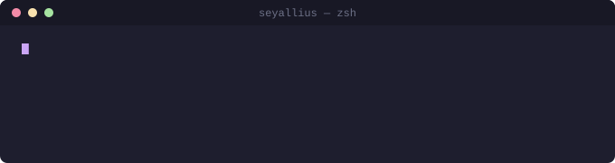

 

<a href="https://www.linkedin.com/in/sayedali-dev">linkedin</a> &nbsp;&middot;&nbsp;
<a href="https://x.com/seyallius">x</a> &nbsp;&middot;&nbsp;
<a href="https://t.me/rdensh01">telegram</a> &nbsp;&middot;&nbsp;
<a href="mailto:seyed.ali.devl@gmail.com">email</a>

  

 

 

