


  


<!-- featured:start -->
<a href="https://github.com/seyallius/govmr">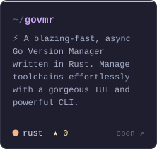</a>
<a href="https://github.com/seyallius/snapdb">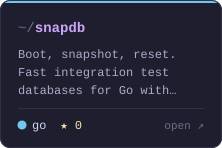</a>
<a href="https://github.com/seyallius/gossip">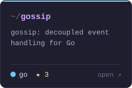</a>
<a href="https://github.com/seyallius/doppel">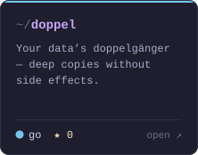</a>
<a href="https://github.com/seyallius/treeclip.v2">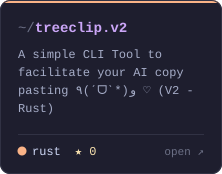</a>
<a href="https://github.com/seyallius/gosaidno">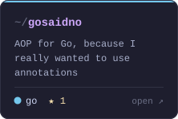</a>
<a href="https://github.com/seyallius/hush">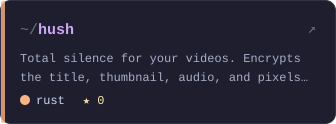</a>
<a href="https://github.com/seyallius/goxide">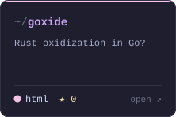</a>
<a href="https://github.com/seyallius/nomnom">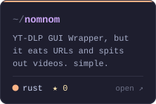</a>
<a href="https://github.com/seyallius/war">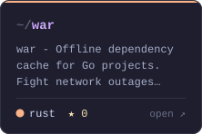</a>
<a href="https://github.com/seyallius/lastcall">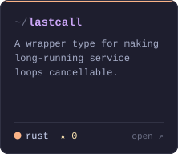</a>
<a href="https://github.com/seyallius/treegotchi">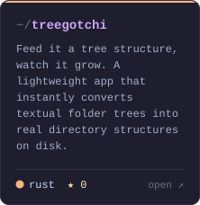</a>
<a href="https://github.com/seyallius/letsgomeeeeeow">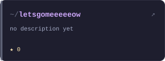</a>
<a href="https://github.com/seyallius/toolkitrs">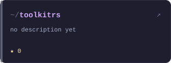</a>
<a href="https://github.com/seyallius/benchbook">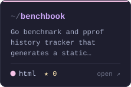</a>
<!-- featured:end -->

  


